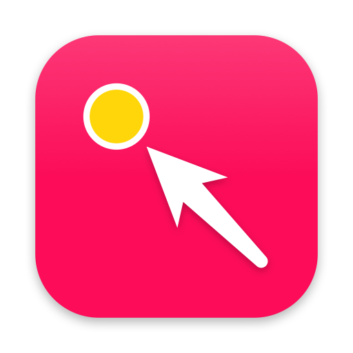
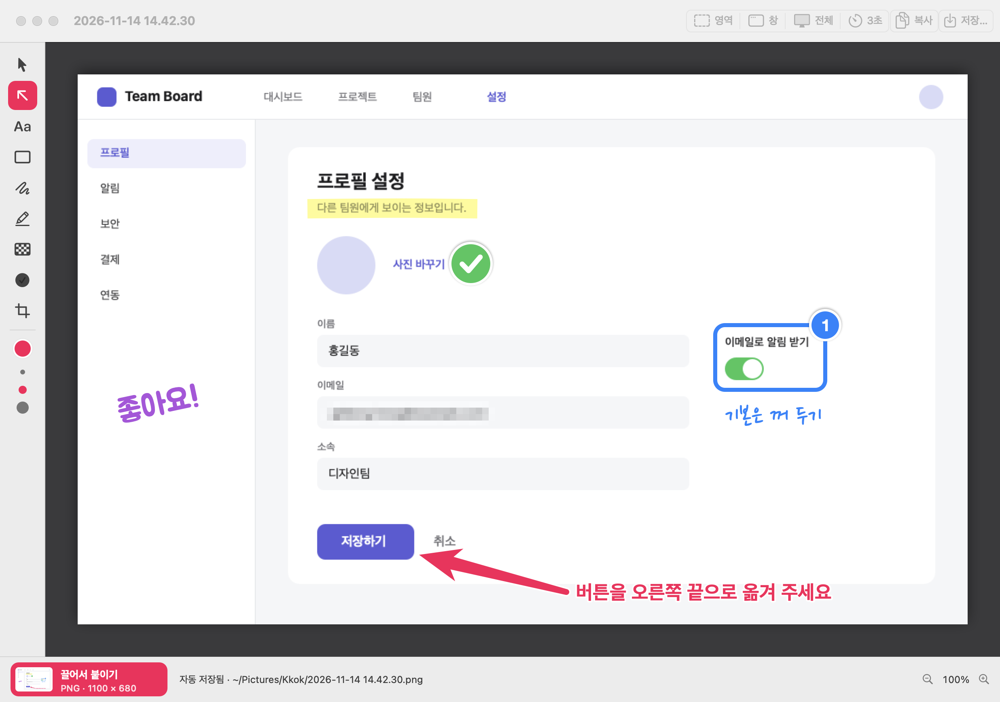
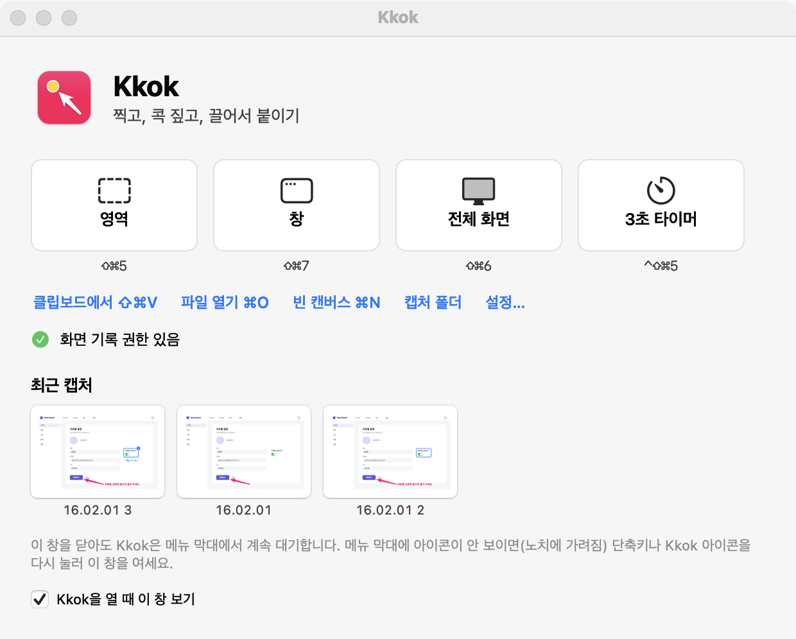
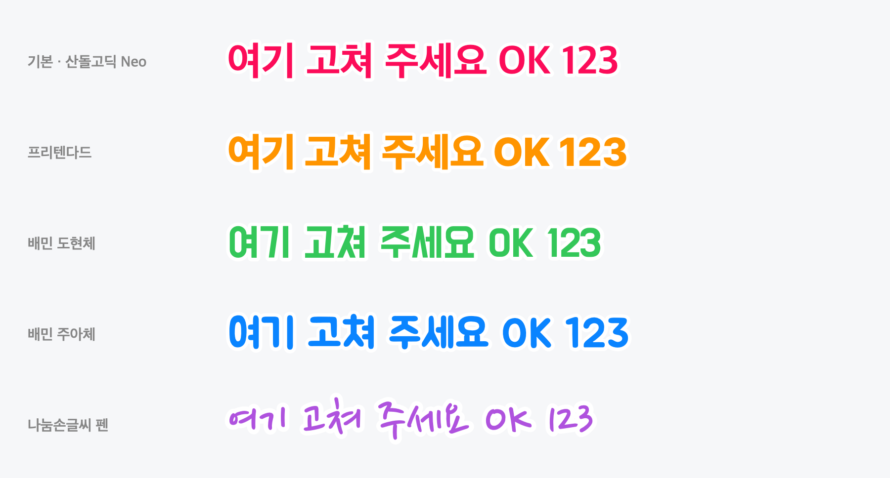

<div align="center">



# Kkok · 콕

**찍고, 콕 짚고, 끌어서 붙이기.**

화면을 캡처해 화살표와 글자로 짚고, 아래 탭을 끌어 메신저에 바로 붙이는 Mac 앱입니다.<br/>
계정 없음 · 인터넷 연결 없음 · 무료 · 오픈소스


[**⬇️ 내려받기**](https://github.com/ReentaKim/Kkok/releases/latest) &nbsp;·&nbsp;
[**📖 사용 가이드**](docs/GUIDE.md) &nbsp;·&nbsp;
[**⌨️ 단축키**](#️-단축키)

<br/>



<sub>화면 속 "Team Board"는 데모용으로 그린 가상의 앱입니다.</sub>

</div>

<br/>

## ✦ 이런 앱입니다

> 버그 위치를 알려 줄 때, 디자인 수정을 부탁할 때, 설정 방법을 설명할 때.<br/>
> **단축키 한 번 → 화살표 하나 → 끌어서 붙이기.** 10초면 끝납니다.

<table>
<tr>
<td width="33%" valign="top">

### 📸 다섯 가지 캡처
영역 · 직전 영역 · 창 · 전체 화면 · 타이머.<br/>
누르는 순간 화면을 얼려서, 고르는 동안 화면이 바뀌어도 그 순간이 찍힙니다.

</td>
<td width="33%" valign="top">

### ✏️ 콕 짚는 주석
점점 굵어지는 화살표, 흰 외곽선 글자, 도형, 펜, 형광펜, 모자이크, 번호·승인 스탬프.<br/>
어떤 배경 위에서도 잘 보입니다.

</td>
<td width="33%" valign="top">

### 🫳 끌어서 붙이기
편집 창 아래 분홍 탭을 Slack·카카오톡·메일·Notion에 끌어다 놓으면 PNG로 들어갑니다.<br/>
⌘C 복사도 됩니다.

</td>
</tr>
<tr>
<td valign="top">

### 🔤 글꼴 5가지
기본 산돌고딕 Neo에 프리텐다드, 배민 도현체, 배민 주아체, 나눔손글씨 펜.<br/>
글자는 돌릴 수도 있습니다.

</td>
<td valign="top">

### 🗂 알아서 보관
찍은 것은 모두 `~/Pictures/Kkok`에 PNG로 저장됩니다.<br/>
"최근 캡처"에서 다시 열면 주석을 그대로 고칠 수 있습니다.

</td>
<td valign="top">

### 🔒 내 Mac 안에서만
계정, 클라우드, 분석 도구, 업데이트 확인이 없습니다.<br/>
인터넷 연결을 전혀 쓰지 않습니다.

</td>
</tr>
</table>

<br/>

<div align="center">

&nbsp;

</div>

<br/>

## 📦 설치

**Homebrew (추천)**

```bash
brew trust --cask reentakim/tap/kkok      # 처음 한 번: 이 tap의 Kkok을 믿고 설치하겠다는 등록
brew install --cask reentakim/tap/kkok
```

업데이트는 `brew upgrade --cask kkok`, 지우기는 `brew uninstall --cask kkok`입니다. Homebrew로 설치하면 "확인되지 않은 개발자" 경고가 뜨지 않습니다.

**직접 받기**: [Releases](https://github.com/ReentaKim/Kkok/releases/latest)에서 `Kkok-x.y.z.zip`을 받아 풀고, `Kkok.app`을 **응용 프로그램** 폴더로 옮깁니다.

처음 캡처할 때 **화면 기록 권한**을 켜 줍니다(시스템 설정 › 개인정보 보호 및 보안 › 화면 및 시스템 오디오 녹음).

<details>
<summary><b>직접 받은 앱을 처음 열 때 "확인되지 않은 개발자" 경고가 뜨면</b></summary>

<br/>

Kkok은 Apple 공증을 받지 않은 개인 프로젝트입니다. 소스가 모두 공개돼 있고 [직접 빌드](#-직접-빌드하기)할 수도 있습니다. Homebrew로 설치하면 이 경고가 뜨지 않습니다.

- **macOS 15 이상**: 한 번 열어 경고를 닫은 뒤 **시스템 설정 › 개인정보 보호 및 보안** 맨 아래의 **"그래도 열기"**를 누릅니다.
- 또는 터미널에서 한 줄:
  ```bash
  xattr -dr com.apple.quarantine /Applications/Kkok.app
  ```

</details>

<details>
<summary><b>⇧⌘5를 눌렀는데 macOS 스크린샷 도구가 뜨면</b></summary>

<br/>

macOS도 ⇧⌘5를 씁니다. 둘 중 하나를 고르세요.

- **시스템 설정 › 키보드 › 키보드 단축키 › 스크린샷**에서 "스크린샷 및 기록 옵션"(⇧⌘5)을 끕니다.
- 또는 Kkok **설정**에서 영역 캡처 단축키를 다른 키로 바꿉니다.

</details>

macOS 14 Sonoma 이상, Apple Silicon·Intel 모두 지원합니다(Intel Mac에서는 아직 실행해 보지 못했습니다).

## ⌨️ 단축키

| 캡처 (어디서나) | | 편집 창 | |
|---|---|---|---|
| 영역 | `⇧⌘5` | 선택 · 화살표 · 글자 | `V` · `A` · `T` |
| 영역, 놓기 전 다듬기 | `⇧⌘5` 후 `⌥` 누른 채 놓기 | 사각형 · 타원 · 선 | `R` · `O` · `L` |
| 직전 영역 다시 | `⌥⇧⌘5` | 펜 · 형광펜 · 모자이크 | `P` · `H` · `B` |
| 창 | `⇧⌘7` | 스탬프 · 자르기 | `S` · `C` |
| 전체 화면 | `⇧⌘6` | 굵기 작게·보통·크게 | `1` · `2` · `3` |
| 3초 타이머 | `⌃⇧⌘5` | 복사 · 저장 · 실행 취소 | `⌘C` · `⌘S` · `⌘Z` |
| 클립보드에서 새로 | `⇧⌘V` | 확대 · 축소 · 실제 크기 | `⌘+` · `⌘-` · `⌘0` |

캡처 단축키는 설정에서 바꿀 수 있습니다. 도구 단축키는 한글 입력 상태에서도 먹습니다. 전체 사용법은 [**사용 가이드**](docs/GUIDE.md)에 있습니다.

## 🙋 Skitch를 쓰던 분께

Kkok은 Skitch의 손에 익은 흐름을 그대로 쓰려고 만들었습니다. Skitch for Mac 2.9는 Intel(x86_64) 전용이라 Apple Silicon에서는 Rosetta 2로만 돌고, 더 이상 업데이트되지 않습니다.

| Skitch | Kkok |
|---|---|
| Crosshair·Previous·Window·Fullscreen·Timed Snapshot | 영역·직전 영역·창·전체·타이머 캡처 |
| Arrow, Text, Shapes, Marker, Highlighter, Pixelate, Stamps | 같은 도구 + 글꼴 5가지·글자 회전 |
| "Drag Me" 탭 | 분홍 "끌어서 붙이기" 탭 |
| Evernote 계정·동기화·공유 | 없음 (내 Mac에만 저장) |
| PDF 주석 | 다음 버전 후보 |

Skitch를 켜 둔 채로 쓰면 같은 단축키에 두 앱이 함께 반응합니다. Skitch(와 Skitch Helper)를 끄고 쓰세요.

## 🛠 직접 빌드하기

Xcode 15 이상(Swift 5.9+)이 필요합니다.

```bash
git clone https://github.com/ReentaKim/Kkok.git
cd Kkok
swift test                       # 모델 테스트
scripts/build-app.sh             # dist/Kkok.app
scripts/build-app.sh --install   # /Applications 에 설치하고 실행
```

`build-app.sh`는 ad-hoc 서명을 하되 지정 요구 사항을 번들 ID로 고정합니다. 그래서 다시 빌드해도 화면 기록 권한이 풀리지 않습니다.

## 📚 문서

| 문서 | 내용 |
|---|---|
| [사용 가이드](docs/GUIDE.md) | 설치부터 캡처·주석·내보내기·설정·문제 해결까지 |
| [PRD](docs/pm/PRD-v0.1.md) | 기능 요구사항(FR)과 수용 기준 |
| [디자인 명세](docs/design/spec-v0.1.md) · [시안](docs/design/prototype-v0.1.html) | 화면 배치, 색, 주석 모양 |
| [아키텍처](docs/dev/architecture.md) | 폴더 구조, 좌표계, 그리기·실행 취소·캡처 흐름 |
| [QA 계획](docs/qa/test-plan-v0.1.md) · [보고서](docs/qa/test-report-v0.1.md) | 검증 방법과 결함 기록 |
| [결정 기록](docs/decisions.md) · [Skitch 분석](docs/rea/skitch-analysis.md) | 왜 이렇게 만들었는지 |

## 📄 라이선스

- 코드: [MIT](LICENSE)
- "Kkok" 이름과 앱 아이콘은 MIT 라이선스에 포함되지 않습니다.
- 글꼴: [프리텐다드](https://github.com/orioncactus/pretendard), [배민 도현체·주아체](https://github.com/google/fonts/tree/main/ofl/dohyeon), [나눔손글씨 펜](https://github.com/google/fonts/tree/main/ofl/nanumpenscript)은 각각 SIL Open Font License 1.1을 따릅니다([원문](Resources/licenses/)).
- Skitch는 Evernote Corporation의 상표입니다. Kkok은 Evernote, Skitch와 관계없는 개인 프로젝트이며, Skitch의 코드나 그림을 쓰지 않았습니다.

<div align="center">
<br/>
<sub>Made with ☕ by <a href="https://github.com/ReentaKim">ReentaKim</a></sub>
</div>
