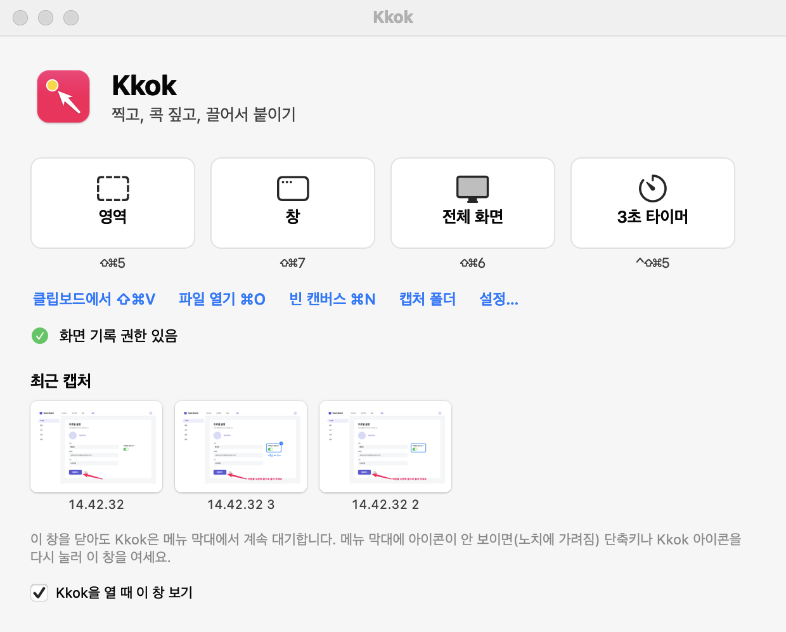
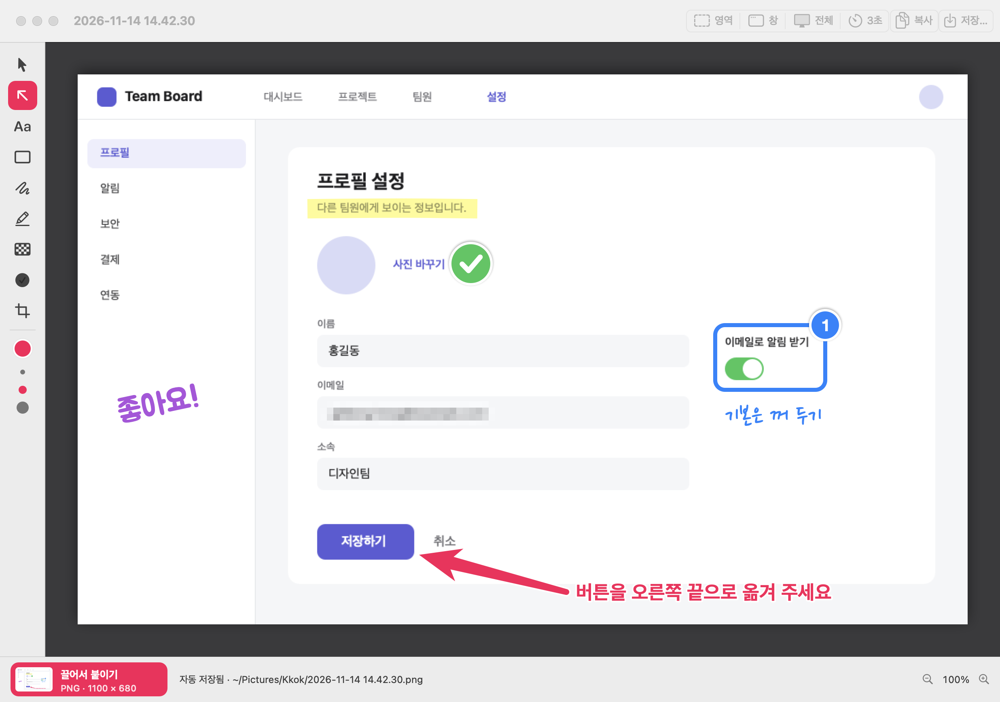
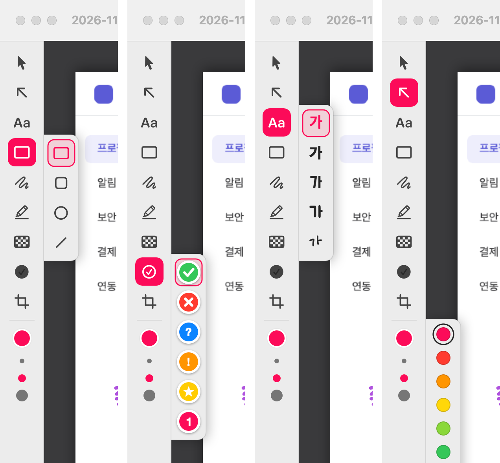
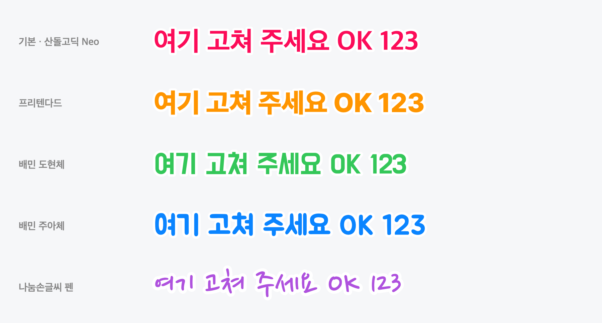
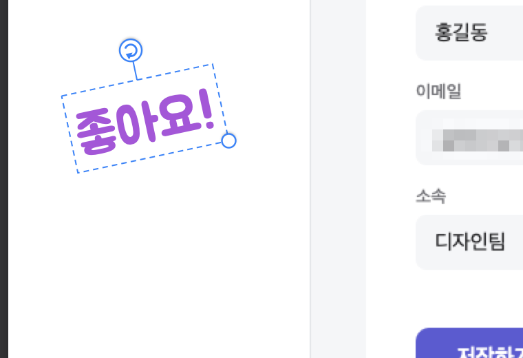

# Kkok 사용 가이드

> 찍고, 콕 짚고, 끌어서 붙이기. Kkok v0.1 기준입니다.

**목차**
1. [설치하기](#1-설치하기)
2. [처음 실행](#2-처음-실행)
3. [캡처하기](#3-캡처하기)
4. [편집 창 둘러보기](#4-편집-창-둘러보기)
5. [주석 도구](#5-주석-도구)
6. [고르기·옮기기·고치기](#6-고르기옮기기고치기)
7. [내보내기](#7-내보내기)
8. [보관과 다시 편집](#8-보관과-다시-편집)
9. [설정](#9-설정)
10. [단축키 한눈에](#10-단축키-한눈에)
11. [문제 해결](#11-문제-해결)
12. [지우기](#12-지우기)

---

## 1. 설치하기

### Homebrew로 설치 (추천)

```bash
brew trust --cask reentakim/tap/kkok      # 처음 한 번
brew install --cask reentakim/tap/kkok
```

- `brew trust`는 최신 Homebrew가 공식 목록 밖의 앱을 설치하기 전에 요구하는 등록입니다. 처음 한 번만 하면 됩니다.
- 업데이트: `brew upgrade --cask kkok`
- 지우기: `brew uninstall --cask kkok` (설정과 보관함까지 지우려면 `brew uninstall --zap --cask kkok`. 내보낸 PNG가 있는 `~/Pictures/Kkok`은 남깁니다)
- Homebrew로 설치하면 아래의 "확인되지 않은 개발자" 경고가 뜨지 않습니다.

### 직접 받아 설치

1. [Releases](https://github.com/ReentaKim/Kkok/releases/latest)에서 `Kkok-x.y.z.zip`을 받아 압축을 풉니다.
2. `Kkok.app`을 **응용 프로그램** 폴더로 옮깁니다.
3. Kkok을 엽니다.

**"확인되지 않은 개발자" 경고가 뜨면.** Kkok은 Apple 공증을 받지 않은 개인 프로젝트라 처음 한 번 경고가 뜹니다.

- 경고를 닫고 **시스템 설정 › 개인정보 보호 및 보안**으로 갑니다. 맨 아래 "Kkok이(가) 차단되었습니다" 옆의 **그래도 열기**를 누릅니다.
- 또는 터미널에서:
  ```bash
  xattr -dr com.apple.quarantine /Applications/Kkok.app
  ```

**요구 사항**: macOS 14 Sonoma 이상. Apple Silicon과 Intel을 모두 지원합니다.

## 2. 처음 실행

Kkok을 열면 **시작 창**이 뜹니다.



- **캡처 버튼 4개**: 영역, 창, 전체 화면, 타이머. 버튼 아래에 단축키가 적혀 있습니다.
- **화면 기록 권한**: 초록 체크가 보이면 준비가 끝난 것입니다. 주황 경고가 보이면 [권한 켜기](#화면-기록-권한-켜기)를 보세요.
- **최근 캡처**: 누르면 그 캡처를 다시 열어 주석을 고칠 수 있습니다.

시작 창을 닫아도 Kkok은 **메뉴 막대**에 남아 기다립니다. 메뉴 막대 아이콘(점을 짚는 작은 화살표)을 누르면 모든 기능이 나옵니다. 처음 실행하면 **로그인할 때 자동으로 실행**되도록 설정됩니다(설정에서 끌 수 있습니다).

시작 창을 다시 보려면 Launchpad나 Finder에서 Kkok을 한 번 더 누르거나, 메뉴 막대 메뉴에서 **Kkok 열기**를 고릅니다.

### 화면 기록 권한 켜기

처음 캡처할 때 macOS가 권한을 묻습니다.

1. **시스템 설정 › 개인정보 보호 및 보안 › 화면 및 시스템 오디오 녹음**을 엽니다.
2. 목록에서 **Kkok**을 켭니다.
3. "종료 후 다시 열기"가 나오면 그대로 따릅니다.

## 3. 캡처하기

| 방식 | 단축키 | 하는 일 |
|---|---|---|
| **영역** | `⇧⌘5` | 십자선이 나오면 끌어서 고르고 놓는 순간 찍힙니다 |
| **직전 영역** | `⌥⇧⌘5` | 바로 전에 고른 영역을 지금 화면으로 다시 찍습니다 |
| **창** | `⇧⌘7` | 마우스를 올린 창이 파랗게 표시됩니다. 누르면 그 창만 그림자 없이 찍힙니다 |
| **전체 화면** | `⇧⌘6` | 마우스가 있는 모니터 전체를 찍습니다 |
| **타이머** | `⌃⇧⌘5` | 영역을 고르면 3초를 센 뒤 찍습니다 |

찍으면 바로 **편집 창**이 열립니다. `esc`를 누르면 언제든 취소됩니다.

**영역을 고를 때**
- 누르는 순간 화면이 멈춥니다. 고르는 동안 화면이 바뀌어도 단축키를 누른 순간이 찍힙니다.
- 끄는 동안 고른 곳 밖은 어두워지고, 가로 × 세로 크기가 보입니다.
- `⇧`를 누르고 끌면 정사각형이 됩니다.
- **⌥를 누른 채 놓으면** 바로 찍지 않고 다듬기 단계로 갑니다. 모서리 손잡이로 크기를, 가운데를 끌어 위치를 고친 뒤 **캡처 ↩** 또는 **3초 후**를 누릅니다.

**타이머는 언제 쓰나요?** 열린 메뉴, 오른쪽 클릭 메뉴, 마우스를 올려야 보이는 툴팁처럼 단축키를 누르면 사라지는 화면을 찍을 때 씁니다. 영역을 고른 뒤 3초 안에 메뉴를 열어 두세요. 시간은 [설정](#9-설정)에서 1~15초로 바꿀 수 있습니다.

**캡처 말고 다른 방법으로 시작하기**
- **클립보드에서 새로 만들기** `⇧⌘V`: 복사해 둔 이미지로 편집 창을 엽니다.
- **파일 열기** `⌘O`: PNG, JPEG 같은 이미지 파일을 엽니다. 편집 창이나 Dock 아이콘에 이미지 파일을 끌어 놓아도 됩니다.
- **빈 캔버스** `⌘N`: 흰 바탕에서 그림을 그립니다.

## 4. 편집 창 둘러보기



| 위치 | 내용 |
|---|---|
| 위 | 새 캡처(영역·창·전체·타이머), **복사**, **저장…** |
| 왼쪽 | 도구, 색, 굵기 3단계. 도형·스탬프·글자 도구와 색은 옆에 하위 막대가 열림 |
| 가운데 | 캡처한 이미지. 확대 `⌘+`, 축소 `⌘-`, 실제 크기 `⌘0` |
| 아래 | 분홍 **끌어서 붙이기** 탭, 자동 저장 위치, 확대 비율(누르면 100%) |

## 5. 주석 도구

왼쪽 도구를 누르거나 키를 누르면 바뀝니다. 도구 키는 한글 입력 상태에서도 먹습니다.

| 도구 | 키 | 쓰는 법 |
|---|---|---|
| 선택 | `V` | 주석을 눌러 고르고, 끌어 옮깁니다 |
| 화살표 | `A` | 꼬리에서 머리 쪽으로 끕니다. 머리로 갈수록 굵어집니다 |
| 글자 | `T` | 누른 곳에 바로 씁니다. 다른 곳을 누르거나 `esc`를 누르면 끝납니다 |
| 도형 | `R` 사각형 · `O` 타원 · `L` 선 | 끌어서 그립니다. `⇧`를 누르면 정사각·정원·45° |
| 펜 | `P` | 자유롭게 그립니다 |
| 형광펜 | `H` | 반투명 굵은 선. 기본은 노랑입니다 |
| 모자이크 | `B` | 끈 영역을 알아볼 수 없게 픽셀로 가립니다 |
| 스탬프 | `S` | 누른 곳에 찍힙니다 |
| 자르기 | `C` | 남길 영역을 끈 뒤 `↩`. 취소는 `esc` |

**하위 막대.** 도형·스탬프·글자 도구를 고르면 도구 막대 오른쪽에 좁은 **하위 막대**가 캔버스 위로 스륵 열립니다. 아이콘을 눌러 종류를 고르고, 이름은 마우스를 올리면 나옵니다. 하위가 없는 도구로 바꾸면 저절로 닫히고, 같은 도구 버튼을 한 번 더 누르면 접었다 폈다 합니다.



- 도형: 사각형, 둥근 사각형, 타원, 선
- 스탬프: 승인 ✓, 거절 ✕, 물음표 ?, 주의 !, 완벽 ★, **숫자**(1, 2, 3… 찍을 때마다 하나씩 늘어남)

**색.** 색 원을 누르면 하위 막대에 12색이 열립니다. 하나 고르면 닫힙니다. 맨 아래 **＋**를 누르면 macOS 색 패널에서 아무 색이나 고를 수 있습니다.

**굵기.** 색 아래 점 3개(작게·보통·크게) 또는 `1` `2` `3`. 글자 크기도 함께 바뀝니다.

**글꼴.** 글자 도구(`T`)를 고르거나 글자를 고르면 하위 막대에 5가지 글꼴이 각자 모양의 **가**로 나옵니다. 쓰고 있는 글자나 고른 글자에도 바로 적용됩니다.



**글자 돌리기.** 글자를 고르면 위쪽에 **↻ 회전 손잡이**가 생깁니다. 끌면 글자 가운데를 중심으로 돌아갑니다. 0°·90°·180°·270° 근처에서는 딱 맞춰지고, `⇧`를 누르면 15°씩 돕니다. 오른쪽 아래 손잡이로 크기를 바꿉니다.



**캔버스 넓히기.** 이미지 가장자리 바깥에 마우스를 올리면 분홍 띠에 **＋**가 보입니다. 누르면 그쪽으로 흰 여백이 생깁니다. 이미지 옆에 설명을 길게 쓸 때 편합니다.

## 6. 고르기·옮기기·고치기

- **고르기**: 주석을 누릅니다. 선택 도구(`V`)에서는 도형 안쪽을 눌러도 골라집니다. `⇧`를 누르고 누르면 여러 개를 고르고, `⌘A`는 전부 고릅니다.
- **옮기기**: 고른 주석을 끕니다. 화살표 키로 1px씩, `⇧`+화살표 키로 10px씩 움직입니다.
- **크기·모양**: 손잡이를 끕니다. 손잡이에 마우스를 올리면 끄는 방향을 가리키는 커서가 나옵니다.

  

- **색·굵기·글꼴 바꾸기**: 주석을 고른 상태에서 색·굵기·글꼴을 바꾸면 그 주석에 적용됩니다.
- **글자 고치기**: 글자를 더블클릭합니다.
- **지우기**: `⌫` 또는 `delete`.
- **실행 취소**: `⌘Z`, 다시 실행 `⇧⌘Z`.

## 7. 내보내기

| 방법 | 하는 일 |
|---|---|
| **끌어서 붙이기** 탭 | 편집 창 아래 분홍 탭을 Slack, 카카오톡, 메일, Notion, Finder 등에 끌어 놓으면 주석이 합쳐진 PNG가 들어갑니다 |
| **복사** `⌘C` | 합쳐진 이미지를 클립보드에 넣습니다. 아무 데나 `⌘V`로 붙입니다 |
| **저장…** `⌘S` | PNG 또는 JPEG 파일로 원하는 곳에 저장합니다 |

Retina 화면에서 찍은 것은 Retina 해상도(2배) 그대로 내보냅니다.

## 8. 보관과 다시 편집

- 찍은 것은 모두 **`~/Pictures/Kkok/`**에 `2026-11-13 14.30.00.png` 같은 이름으로 저장됩니다. 주석을 고치면 0.6초 뒤 자동으로 다시 저장됩니다.
- 원본과 주석 정보는 `~/Library/Application Support/Kkok/history/`에 따로 있습니다. 그래서 다시 열어도 주석을 하나씩 고칠 수 있습니다.
- **다시 열기**: 시작 창의 최근 캡처, 또는 메뉴 막대 메뉴 › **최근 항목**.
- **폴더 열기**: 메뉴 막대 메뉴 › **캡처 폴더 열기**.

## 9. 설정

메뉴 막대 메뉴 › **설정…** (`⌘,`)

| 항목 | 설명 |
|---|---|
| 캡처 단축키 | 칸을 누르고 새 키 조합을 누릅니다. `⌫`는 지우기, `esc`는 취소. 다른 캡처 방식과 겹치면 그쪽 단축키가 비워집니다 |
| 타이머 | 1~15초 (기본 3초) |
| 로그인할 때 Kkok 실행 | 기본 켬 |
| Kkok을 열 때 이 창 보기 | 시작 창 아래쪽 체크 상자 |

## 10. 단축키 한눈에

**어디서나 (캡처)**

| | |
|---|---|
| 영역 | `⇧⌘5` (놓기 전 `⌥` = 다듬기) |
| 직전 영역 | `⌥⇧⌘5` |
| 창 | `⇧⌘7` |
| 전체 화면 | `⇧⌘6` |
| 타이머 | `⌃⇧⌘5` |

**편집 창**

| | |
|---|---|
| 도구 | `V` 선택 · `A` 화살표 · `T` 글자 · `R` 사각형 · `O` 타원 · `L` 선 · `P` 펜 · `H` 형광펜 · `B` 모자이크 · `S` 스탬프 · `C` 자르기 |
| 굵기 | `1` `2` `3` |
| 자르기 적용 / 취소 | `↩` / `esc` |
| 지우기 | `⌫` |
| 옮기기 | 화살표 키 (`⇧` = 10px) |
| 모두 고르기 | `⌘A` |
| 복사 · 저장 · 닫기 | `⌘C` · `⌘S` · `⌘W` |
| 실행 취소 · 다시 실행 | `⌘Z` · `⇧⌘Z` |
| 확대 · 축소 · 실제 크기 | `⌘+` · `⌘-` · `⌘0` |
| 클립보드에서 새로 · 열기 · 빈 캔버스 | `⇧⌘V` · `⌘O` · `⌘N` |

## 11. 문제 해결

**⇧⌘5를 누르면 macOS 스크린샷 도구가 떠요.**
macOS도 ⇧⌘5를 씁니다. **시스템 설정 › 키보드 › 키보드 단축키… › 스크린샷**에서 "스크린샷 및 기록 옵션"을 끄세요. 또는 Kkok 설정에서 영역 캡처 단축키를 바꾸세요.

**캡처할 때 다른 캡처 앱도 같이 떠요.**
Skitch처럼 같은 단축키를 쓰는 앱이 켜져 있으면 두 앱이 함께 반응합니다. 그 앱을 끄거나, 한쪽 단축키를 바꾸세요. 설정 창 아래에 빨간 글씨로 "등록하지 못함"이 보이면 다른 앱이 그 키를 먼저 차지한 것입니다. 그 앱을 끄면 Kkok이 1분 안에 다시 잡습니다.

**메뉴 막대에 Kkok 아이콘이 안 보여요.**
메뉴 막대 아이콘이 많으면 MacBook 노치 뒤로 가려질 수 있습니다. 단축키는 그대로 동작하고, Kkok을 한 번 더 열면 시작 창이 뜹니다.

**권한을 켰는데도 "화면 기록 권한이 필요합니다"가 떠요.**
Kkok을 완전히 끄고(`⌘Q` 또는 메뉴 막대 메뉴 › Kkok 종료) 다시 여세요. 그래도 안 되면 권한 목록에서 Kkok을 지웠다가(−) 다시 추가하세요.

**캡처하면 배경만 찍히고 창 내용이 안 보여요.**
화면 기록 권한이 꺼져 있을 때 생기는 일입니다. 위와 같이 권한을 확인하세요.

**모자이크는 안전한가요?**
모자이크는 원본을 큰 칸으로 뭉개서 그립니다. 내보낸 PNG에서 가린 글자는 복원할 수 없습니다. 다만 Kkok 보관함(`~/Library/Application Support/Kkok/history/`)에는 다시 고칠 수 있도록 원본이 남아 있습니다.

## 12. 지우기

Homebrew로 설치했다면 `brew uninstall --cask kkok` 한 줄이면 됩니다(`--zap`을 붙이면 설정과 보관함도 지웁니다). 직접 설치했다면:

1. 메뉴 막대 메뉴 › **Kkok 종료**
2. `/Applications/Kkok.app`을 휴지통으로
3. 필요하면 데이터도 지웁니다:
   ```bash
   rm -rf ~/Library/Application\ Support/Kkok   # 원본·주석 보관함
   rm -rf ~/Pictures/Kkok                        # 내보낸 PNG (지우기 전에 확인하세요)
   defaults delete io.github.reentakim.kkok      # 설정
   ```
4. **시스템 설정 › 일반 › 로그인 항목**에서 Kkok이 남아 있으면 지웁니다.
